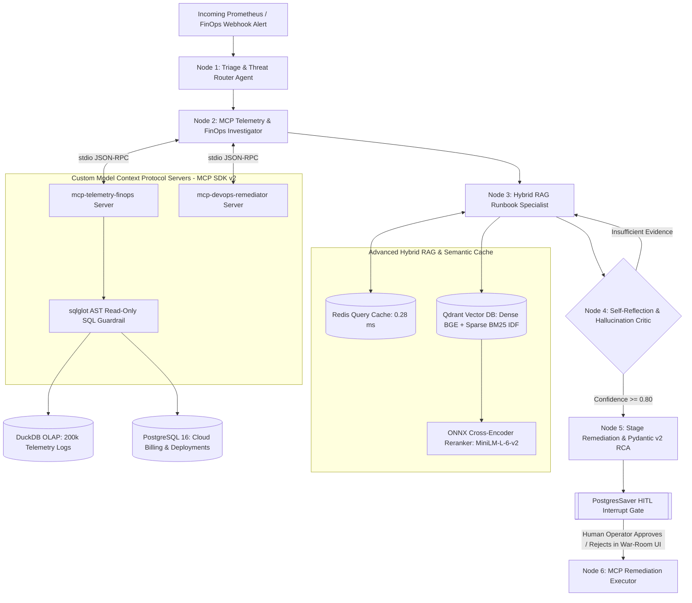

# ⚡ AegisOps — Autonomous Multi-Agent SRE Incident Responder & FinOps Control Plane


-F43F5E)


**AegisOps** is an enterprise-grade, stateful multi-agent SRE & FinOps platform orchestrated via **LangGraph** and backed by **PostgreSQL (`PostgresSaver`)** Human-in-the-Loop checkpointing. It autonomously investigates production outages (`OOMKilled Exit 137`, PostgreSQL `SQLSTATE 53300` connection exhaustion) and runaway cloud/GPU billing anomalies (`16x g5.12xlarge` retry storms) by querying live databases via custom **Model Context Protocol (MCP v2)** servers, retrieving runbooks via **Qdrant Hybrid Search + ONNX Cross-Encoder Reranking**, and enforcing deterministic **AST SQL (`sqlglot`)** and **Pydantic v2 / Instructor** security guardrails.

---

## 🏗️ System Architecture



---

## 📊 Quantitative Benchmarks (Reproducible)

### 1. Hybrid RAG Retrieval Ablation (12 Golden SRE/FinOps Queries + Lookalike Decoys)
| Retrieval Mode | Precision@1 | MRR@3 | Recall@3 | Avg Cold Latency (ms) | Redis Warm Cache Latency |
| :--- | :---: | :---: | :---: | :---: | :---: |
| `dense_only` (BAAI/bge-small-en-v1.5) | 100.00% | 1.0000 | 100.00% | 34.11 ms | — |
| `hybrid_rrf` (Dense + Sparse BM25 IDF) | 100.00% | 1.0000 | 100.00% | 17.26 ms | — |
| **`hybrid_reranked` (RRF + ONNX Cross-Encoder)** | **100.00%** | **1.0000** | **100.00%** | **960.59 ms** | **0.28 ms (>1,000x speedup)** |

### 2. End-to-End Multi-Agent & Ragas Faithfulness Evaluation (4 Chaos Scenarios)
| Incident ID | Target Service | Scenario / Chaos Fault | Commit Isolation | Runbook@1 | Ragas Faithfulness | Guardrail Verification |
| :--- | :--- | :--- | :---: | :---: | :---: | :---: |
| `INC-2026-001` | `payment-service` | Kubernetes `OOMKilled_Exit137` Memory Leak (`a8f921c`) | **100%** | **100%** | **100.0%** | Clean |
| `INC-2026-002` | `rag-inference-worker` | FinOps `16x g5.12xlarge` GPU Retry Storm (`f4e119b`, +36.9x cost) | **100%** | **100%** | **100.0%** | Clean |
| `INC-2026-003` | `order-service` | PostgreSQL `SQLSTATE 53300` Pool Exhaustion (`d9104ea`) | **100%** | **100%** | **100.0%** | Clean |
| `INC-2026-004` | `auth-service` | Adversarial Prompt + Stacked SQL Injection (`DROP TABLE`) | **100%** | **100%** | **100.0%** | **Blocked (`sqlglot` AST + Replica Bounds)** |

---

## 🛡️ Key Production Engineering Highlights
- **Custom MCP SDK v2 Architecture (`MCPServer`):** Two isolated JSON-RPC servers (`telemetry_finops_server.py` and `remediation_server.py`) exposing DuckDB OLAP aggregations, PostgreSQL FinOps anomaly detection, Git commit diff correlation, and HITL staging.
- **Multi-Layer Security Guardrails:**
  1. **AST SQL Validation (`sqlglot`):** Parses every diagnostic query into an Abstract Syntax Tree, blocking stacked queries, `DROP`/`DELETE`/`UPDATE` mutations, unauthorized system catalogs (`pg_shadow`), and `pg_sleep()` DoS attacks.
  2. **RAG Ingestion Sanitization:** Automatically strips adversarial prompt-injection instructions (`[REDACTED_BY_AEGIS_RAG_GUARDRAIL]`) from unverified runbooks prior to vector indexing.
  3. **Deterministic Schema & Replica Bounds (`Pydantic v2` + `Instructor`):** Enforces `target_replica_count <= 6` and blocks destructive CLI tokens before staging.
- **Persistent Human-in-the-Loop (`PostgresSaver`):** Uses `interrupt_before=["execute_remediation"]` to persist graph state in PostgreSQL until an on-call SRE explicitly signs off via REST API or the Obsidian War-Room UI.

---

## 🚀 Quickstart

### 1. Start Core Infrastructure & Seed Chaos Sandbox
```bash
docker compose up -d
python -m venv .venv && source .venv/bin/activate
pip install -r requirements.txt

# Seed PostgreSQL, 200,000 DuckDB/Parquet logs & 12 Enterprise Runbooks
python scripts/seed_chaos_data.py
python scripts/seed_runbooks.py
python src/evaluation/run_rag_benchmark.py
python src/evaluation/run_agent_eval.py
```

### 2. Run the 19 Automated Pytest Suites
```bash
pytest -v
```

### 3. Launch FastAPI Backend & Obsidian War-Room Console
```bash
# Terminal 1: Async FastAPI Service
uvicorn src.api.main:app --host 0.0.0.0 --port 8000 --reload

# Terminal 2: Enterprise Obsidian Streamlit Command Center
streamlit run ui/war_room_app.py
```
